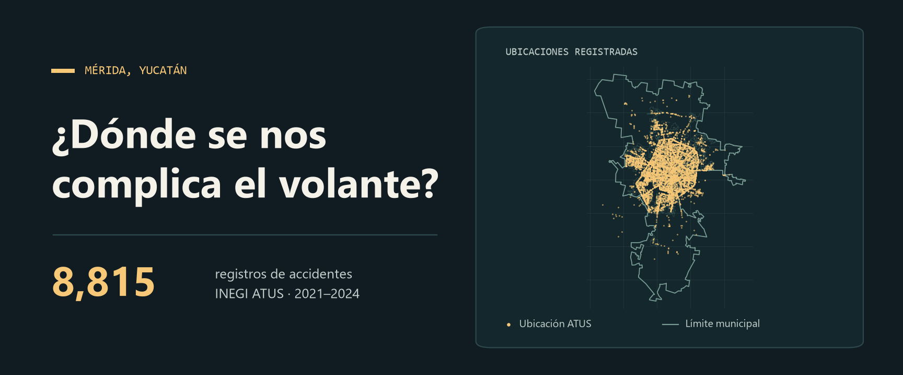

# Datos viales de Mérida

Archivos y fuentes para el ETL del dashboard de accidentes viales en el **municipio de Mérida, Yucatán (31050)**. El punto de partida es el registro georreferenciado de accidentes de INEGI.

[Capítulo del booklet](booklet/) · [Datos de las escenas](booklet/datos/FUENTES.md) · [Código de reproducción](scripts/)

[Descargas](#descargas) · [Procedencia y acceso](#procedencia-y-acceso) · [Fuentes en preparación](#fuentes-en-preparación) · [Claves para el ETL](#claves-para-el-etl)

## Descargas

**Empieza por [ATUS con geografía](datos/para-etl/atus/accidentes_merida_enriquecido.csv)** para trabajar por zona, o usa el [CSV limpio](datos/para-etl/atus/accidentes_merida.csv) para trabajar por accidente.

| Datos | Alcance | Archivos |
| --- | --- | --- |
| **Accidentes · INEGI ATUS** | 8,815 registros en Mérida · 2021–2024 | [CSV limpio](datos/para-etl/atus/accidentes_merida.csv) · [CSV con geografía](datos/para-etl/atus/accidentes_merida_enriquecido.csv) · [GeoJSON original](datos/originales/atus/accidentes_merida.geojson) |
| **Límites y AGEB · INEGI** | Marco Geoestadístico · diciembre de 2025 | [Municipio](datos/originales/marco-geoestadistico/mgem_31050.geojson) · [AGEB urbanas](datos/originales/marco-geoestadistico/agebu_31050.geojson) · [AGEB rurales](datos/originales/marco-geoestadistico/agebr_31050.geojson) |
| **Establecimientos · INEGI DENUE** | 56,909 establecimientos · edición 2026/05 corregida | [CSV para ETL](datos/para-etl/denue/establecimientos_merida.csv) |
| **Aforos · SICT** | 4,169 observaciones de Yucatán · 2013–2024 | [CSV para ETL](datos/para-etl/sict/datos_viales_yucatan.csv) · [JSON originales](datos/originales/sict/) |
| **Transporte sostenible · SIEGY** | Seis indicadores del boletín 2025-11 | [CSV de indicadores](datos/para-etl/siegy/indicadores_movilidad_siegy_2025_11.csv) · [Boletín PDF](datos/originales/siegy/boletin_2025_11_transporte_sostenible.pdf) |
| **Cobertura de prensa** | 34 artículos revisados · 25 incluidos en la muestra | [Enlaces y metadatos (CSV)](datos/para-etl/prensa/referencias.csv) |

Los archivos de trabajo están en [`datos/para-etl/`](datos/para-etl/) y las copias de origen en [`datos/originales/`](datos/originales/). Puedes usar los datos descargados sin acceso a la VM.

## Procedencia y acceso

- **ATUS.** La ficha registra la capa, la paginación y el filtro de Mérida `EDO=31 AND MPIO=50`. [Programa ATUS](https://www.inegi.org.mx/programas/accidentes/) · [Servicio WFS](https://mapas.inegi.org.mx/geoserver/wfs) · [Ficha de descarga](datos/originales/atus/accidentes_merida.fuente.json)
- **Marco Geoestadístico.** El manifiesto identifica las capas, la edición y las URL directas de cada geometría. [Catálogo de INEGI](https://www.inegi.org.mx/servicios/catalogounico.html) · [Manifiesto de las capas](datos/originales/marco-geoestadistico/fuentes.json)
- **DENUE.** El extracto conserva ID, actividad, estrato, coordenadas y validación. Para actualizarlo, usar `BuscarAreaAct` con entidad `31`, municipio `050` y un token propio. [API de INEGI](https://www.inegi.org.mx/servicios/api_denue.html)
- **SICT.** El catálogo indica licencia CC BY 4.0. El manifiesto detalla la descarga por CKAN y el filtro por Yucatán. [Datos viales](https://www.datos.gob.mx/es/dataset/datos_viales) · [Manifiesto](datos/originales/sict/provenance.json)
- **SIEGY.** La tabla transcribe los indicadores del boletín oficial. [Boletín del Gobierno de Yucatán](https://datos.yucatan.gob.mx/storage/boletines/archivos/2025/Boletin_2025_11.pdf) · [Ficha de descarga](datos/originales/siegy/boletin_2025_11_metadata.json)
- **Prensa.** El CSV conserva las URL por artículo, la fecha de publicación, la fecha del hecho cuando se pudo identificar y el estado de revisión. Los textos y las fotos se consultan en cada medio. [La Jornada Maya](https://www.lajornadamaya.mx/) · [Yucatán al Instante](https://www.yucatanalinstante.com/)

## Fuentes en preparación

| Parte | Estado y acceso |
| --- | --- |
| **GeoPortal de Mérida** | Capa **GENERAL → Calles** pendiente de adquisición. Para el piloto se puede usar la cartografía INEGI de arriba. [Visor municipal](https://geoportal.merida.gob.mx/) |
| **Solicitud gubernamental** | Borrador preparado para solicitar registros de hechos viales. Falta presentar la solicitud. [Unidad de Transparencia de la SSP Yucatán](https://transparencia.yucatan.gob.mx/ssp/unidad-transparencia) |
| **Datos propios** | Instrumento preparado y recolección pendiente. [Plantilla de captura vacía](preparacion/encuesta/survey_template.csv) · [Diccionario del instrumento](preparacion/encuesta/survey_schema.json) |
| **LiDAR** | Búsqueda documentada. Falta un producto utilizable para Mérida. [Índice de fichas con enlaces oficiales](preparacion/lidar/indice_productos.csv) |
| **Realidad aumentada** | Prototipo de presentación de tres zonas con datos derivados de ATUS y DENUE. [Datos de las zonas](preparacion/ar/locations.json) · [Método de selección](preparacion/ar/overview.json) · [WebXR](https://developer.mozilla.org/es/docs/Web/API/WebXR_Device_API) |

## Claves para el ETL

1. **ATUS y geografía.** Usa `OID` como identificador del registro. Para contar accidentes por AGEB, usa las asignaciones únicas y reporta la cobertura de esa unión. Conserva los códigos originales y los valores desconocidos.
2. **DENUE y SICT.** Usa DENUE 2026 como contexto espacial para ATUS 2021–2024. Para los aforos, conserva el año, la distancia y el estado de validación de las coordenadas. [Validación SICT](datos/para-etl/sict/validacion.json)
3. **SIEGY y prensa.** Mantén cada indicador SIEGY en su periodo y territorio. Cuenta un valor estatal una sola vez aunque aparezca en varios registros tras una unión. En prensa, distingue la fecha de publicación de la fecha del hecho.

La portada se generó con las ubicaciones ATUS y el Marco Geoestadístico de INEGI. Cada punto del mapa marca una ubicación en la que puede haber varios registros.

